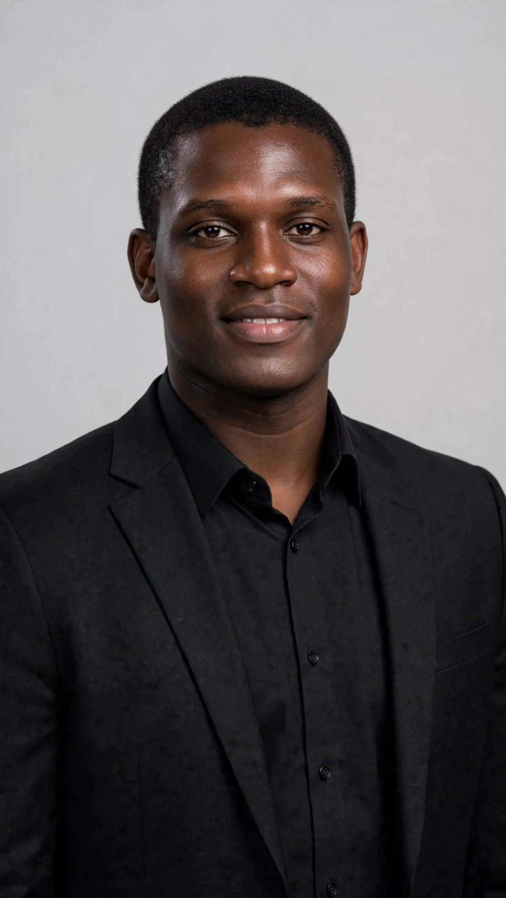

markdown

  

<h1 align="center">ARIHO ADRIANO</h1>

  <b>BSc Computer Science Student | Uganda Christian University (UCU)</b> 
  Reg No: S26B23/116

  📧 arihoadriano@gmail.com | 📞 0701941179 | 📍 Mukono, Uganda 
  <a href="https://github.com/arihoadriano-png">GitHub</a> • 
  <a href="https://www.linkedin.com/in/ariho-adriano">LinkedIn</a>

---

### 👋 PERSONAL PROFILE
I am Ariho Adriano, a motivated BSc Computer Science undergraduate at Uganda Christian University (UCU).
I did BCM (Biology, Chemistry, Mathematics) at A' Level. My childhood dream is to save lives, and I am now pursuing it through technology by merging health science with computer science to build life-saving solutions.

### 🎓 EDUCATION
**Uganda Christian University (UCU) - 2026 to Present**  
Bachelor of Science in Computer Science (BSCS) - Pursuing  
Reg No: S26B23/116

**A-Level: Merryland High School Entebbe**  
BCM (Biology, Chemistry, Mathematics)

### 🎯 CAREER OBJECTIVE
To contribute to life-saving health technology that improves patient monitoring and emergency response, especially in under-resourced communities in Uganda.

### 💻 TECHNICAL SKILLS
- **Languages:** C Programming, Python Basics, HTML/CSS
- **Core:** Problem Solving, Embedded Systems & Algorithms
- **Hardware:** Microcontrollers - Arduino, Embedded Hardware Basics
- **Tools:** Git, GitHub, VS Code, MATLAB Basics

### 🚀 PROJECTS & EXPERIENCE

#### 1. LVAS - Lecture Verification Attendance System (Ongoing)
**Problem:** Proxy attendance and manual sheets waste time.  
**Solution:** A C-based system where lecturers generate a time-based code and students verify attendance.  
**Features:** Lecturer login, code generation, student verification, attendance file storage with timestamp.  
**Tech:** C, File Handling

#### 2. Data Organization for Kaggle - Academic Support (Completed)
Assisted lecturer in organizing and preparing academic datasets for upload to Kaggle.  
**Responsibilities:** Data cleaning, structuring datasets into CSV format, removing duplicates, and proper documentation.  
**Skills Gained:** Data Cleaning, CSV Handling, Kaggle, Data Documentation.

#### 3. Coursework Deadline Tracker 
Personal C tool to track UCU coursework deadlines and prevent missed submissions.  
**Tech:** C Programming

### 💡 INTERESTS
Health Technology | Embedded Systems | Patient Monitoring | Data Science for Health

---

© 2026 Ariho Adriano - Built with GitHub Pages 
<b>https://arihoadriano-png.github.io</b>

